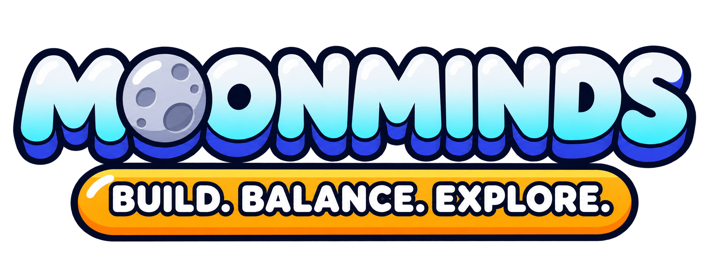
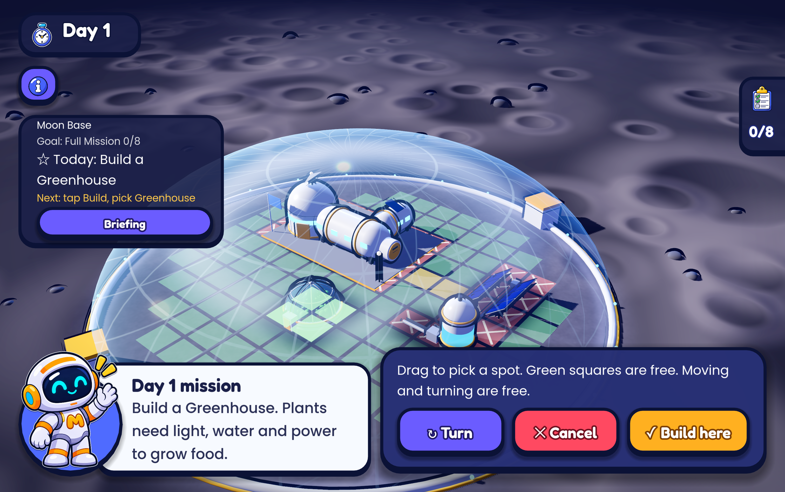

<div align="center">



### A small Moon base. A big reason to be curious.

A 3D space science game for ages 7–12, created by **Pixel Pulsars** for the **NASA Space Apps Challenge**.

**Think · Discover · Build · Reflect**

</div>



## Welcome to your Moon base

What would you do if mold appeared on your space-grown flowers? How would you fix a rover with the supplies already on board?

MoonMinds starts with questions like these. Players meet real problems from NASA missions, choose a possible solution, discover what happened, and bring a related idea into their own lunar outpost. With Robo as their guide, they build toward a South Pole Science Base, one mission at a time.

## One mission, one new idea

1. **Think.** Read a short NASA story and choose how you would tackle the problem.
2. **Discover.** Get a helpful hint if needed, then see what NASA actually did.
3. **Build.** Place a greenhouse, investigate lunar ice, research a rover, improve solar panels, or prepare radiation protection.
4. **Reflect.** Answer a “why did it work?” question and connect the science to your mission.

Name your base, pick a flag, and choose where your buildings go. Earn science stars, collect concept badges, unlock decorations, and revisit completed missions in your Mission Log. Save and continue when you are ready for more.

The current experience focuses on guided learning and building. Resource bars, construction costs, and survival management are disabled for new campaigns.

## Choose your training

| Campaign | Missions | Your focus |
| --- | ---: | --- |
| **Apollo Explorer** | 3 | Research a rover, build it, and head out on a field trip. |
| **Moon Base Builder** | 5 | Explore water, plants, sunlight, and radiation protection. |
| **Full Mission** | 8 | Follow the complete learning journey. |

“Days” are mission steps inside the game; you can play through them in one sitting or return later.

## Run the project

Use **Godot 4.7**; this source was checked with **Godot 4.7.2**.

1. Clone or download this repository.
2. In Godot's Project Manager, choose **Import** and select `project.godot`.
3. Let Godot finish importing the bundled assets.
4. Press **F6** with `scenes/main.tscn` open, or **F5** to run the project.

With Godot on your command line, you can also run:

```sh
godot --headless --path . --import
godot --path .
```

The game uses Godot's Mobile renderer and a 1024 × 576 base viewport. Large buttons support touch interaction; mouse input works too. No NASA API key or separate data download is required to play.

## Inside the source

| Path | Contents |
| --- | --- |
| `scenes/main.tscn` | Main scene and lunar world. |
| `scenes/core/` | Campaigns, mission rules, saves, NASA data access, and rewards. |
| `scenes/buildings/` | Procedural 3D buildings and rover. |
| `scenes/audio/` | Music and sound effect directors. |
| `ui/` | Mission cards, quizzes, menus, Robo, and visual themes. |
| `assets/` | Game artwork, fonts, textures, and audio. |
| `nasa_db/` | Bundled processed NASA resources and their source manifest. |

Built with **Godot and GDScript**. This repository contains the playable project; internal preparation scripts, raw source archives, and development handoff documents are excluded.

## Real missions, clearly explained

Our learning missions draw on the Veggie zinnia garden, LCROSS, Apollo 14, Apollo 15, Apollo 17, the ISS roll-out solar arrays, solar storms, and Orion's radiation protection planning.

NASA photographs accompany the stories. Lunar polar illumination data supports sunlight facts, and a NASA Apollo Lunar Module model appears in the base. Each resource's origin, credit, and processing details are recorded in [`nasa_db/manifest.csv`](nasa_db/manifest.csv).

The Moon base, Robo, mission sequence, and gameplay values are fictional. Stories identify when the real event took place aboard the Space Station or another spacecraft rather than on the Moon. MoonMinds is an independent project and does not imply NASA endorsement.

## Credits & AI assistance

MoonMinds was created by **Pixel Pulsars**. AI tools assisted development, writing, and the creation of game artwork. ElevenLabs generated sound effects; asset-generation records and audio prompts are included alongside the assets. Real NASA photographs and data are credited separately.

- **NASA resources:** [`source manifest`](nasa_db/manifest.csv).
- **Music and sound:** [`audio credits`](assets/audio/CREDITS.md), including tracks by Aureolus_Omicron, Cleyton Kauffman, Bobjt, and a sound effect by Umplix.
- **Earth texture:** [`texture credits`](assets/textures/CREDITS.md), NASA Blue Marble via Wikimedia Commons.
- **Typography:** Fredoka and Poppins, with their SIL Open Font License files in [`assets/fonts/`](assets/fonts/).

Third-party resources retain their respective licenses. Learning benefits are the project's intended outcome; they have not been established through a formal study with children.

<div align="center">


**See a problem. Try an idea. Make your next discovery.**

</div>
